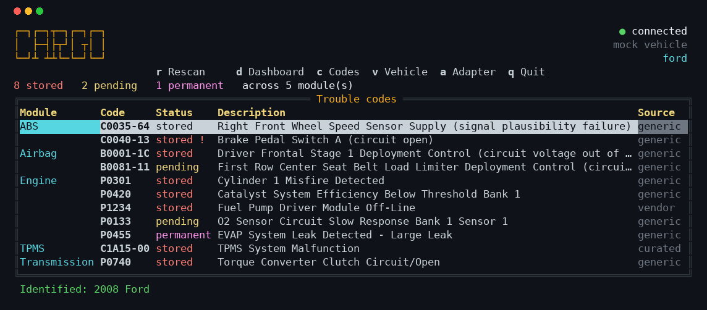

<p align="center">
  
</p>

<h1 align="center">cargo</h1>

<p align="center">
  A command-line OBD-II tool. Reads live data and diagnostic trouble codes
  <br>from a vehicle through an ELM327 adapter.
</p>

<p align="center">
  <a href="https://github.com/fallais/cargo/actions/workflows/ci.yml">
    
  </a>
  <a href="https://github.com/fallais/cargo/releases">
    
  </a>
  <a href="https://pkg.go.dev/github.com/fallais/cargo">
    
  </a>
  <a href="https://goreportcard.com/report/github.com/fallais/cargo">
    
  </a>
  <a href="go.mod">
    
  </a>
  <a href="LICENSE">
    
  </a>
  
  
</p>

## Screenshot

<p align="center">
  
</p>

Codes grouped by the ECU that reported them. The chassis and airbag faults came
over UDS, so they carry a failure type (`C0035-64`) saying how the part failed,
and the `!` marks one whose module is asking for a warning lamp. `P1234` reads
as Ford's definition because the VIN identified the car.

## Usage

```
go install github.com/fallais/cargo@latest

# or from a clone
go build -o cargo .

./cargo                 # terminal UI
./cargo --no-tui        # one-shot report
./cargo --vin           # print the VIN and exit
./cargo --detail        # report with each fault's history
./cargo modules         # find every module and say what it is
./cargo clear           # erase trouble codes, after asking
```

Keys: `d` dashboard, `c` codes, `v` vehicle, `a` adapter, `q` quit.

## Connecting

The UI starts without attaching to anything. The adapter page (`a`) lists the
devices it can see, and `enter` connects to the one you pick, because attaching
to a car is not something to do behind your back.

`t` on that page turns on autoconnect, which attaches to the first adapter that
answers and reattaches if the cable is pulled. `--autoconnect` starts that way.
The one-shot report has no picker, so it always connects on its own.

## Flags

| | |
|---|---|
| `--port` | adapter device (default: scan `ttyUSB*`, `ttyACM*`, `rfcomm*`) |
| `--baud` | serial rate (default: probe 38400, 9600, 115200, 230400, 500000) |
| `--make` | vehicle marque, overriding the selected vehicle for one run |
| `--autoconnect` | attach to the first adapter that answers, without being asked |
| `--theme` | `terminal` keeps your background, `dark` paints its own |
| `--no-tui` | print one report and exit |
| `--vin` | print the VIN alone and exit |
| `--detail` | show how often each fault happened, and at what mileage |
| `--sweep` | look for modules at every diagnostic address first (engine off) |
| `--debug` | verbose logging |

Any flag can also be set via `CARGO_*` environment variables or
`$XDG_CONFIG_HOME/cargo/cargo.yaml`.

## How it works

A car is a network of computers, the ECUs, one per system. Each keeps its own
fault memory and speaks its own protocol. A diagnostic tool reaches them
through an adapter plugged into the OBD-II port, and asks each one in turn.

<p align="center">
  
</p>

Each code says which system, how the component failed, and what state the
fault is in:

<p align="center">
  
</p>

## Licence

MIT. See [LICENSE](LICENSE). The bundled trouble-code data comes from
third-party datasets; see [NOTICE](NOTICE).
